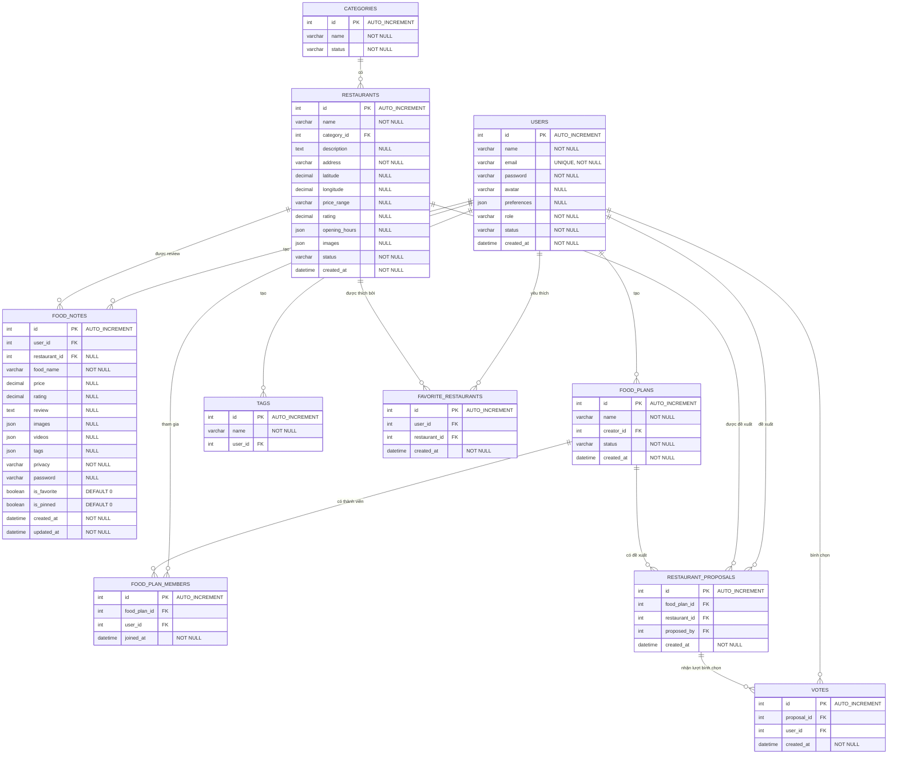

# Thiết kế CSDL (ERD & Database Diagram) - What2Eat

> Tài liệu này là bản thiết kế ban đầu. Schema triển khai hiện tại nằm ở `api/schema.sql`; bảng `restaurant_sponsorships` quản lý lịch tài trợ, `place_reports` và `osm_place_blocks` quản lý chất lượng địa điểm, còn `users.session_version` vô hiệu hóa phiên cũ sau khi đổi/đặt lại mật khẩu.

Dưới đây là thiết kế chi tiết cơ sở dữ liệu (Database Schema) và sơ đồ quan hệ thực thể (ERD) cho nền tảng **What2Eat**, dựa trên cấu trúc các bảng đã được chuẩn hóa.

## 1. Entity-Relationship Diagram (ERD)

Bạn có thể copy đoạn code dưới đây vào [Mermaid Live Editor](https://mermaid.live/) hoặc xem trực tiếp trên GitHub/Notion có hỗ trợ Mermaid.

## 2. THIẾT KẾ CHI TIẾT CÁC BẢNG

### 2.1. Bảng User (`users`)
| Thuộc tính | Kiểu dữ liệu | Ràng buộc | Ý nghĩa |
| :--- | :--- | :--- | :--- |
| `id` | INT | PK, AUTO_INCREMENT | Mã người dùng |
| `name` | VARCHAR(100) | NOT NULL | Họ tên |
| `email` | VARCHAR(255) | UNIQUE, NOT NULL | Email đăng nhập |
| `password` | VARCHAR(255) | NOT NULL | Mật khẩu đã mã hóa |
| `avatar` | VARCHAR(255) | NULL | Đường dẫn ảnh đại diện |
| `preferences` | JSON | NULL | Sở thích ăn uống |
| `role` | VARCHAR(20) | NOT NULL | User/Admin |
| `status` | VARCHAR(20) | NOT NULL | Trạng thái tài khoản |
| `created_at` | DATETIME | NOT NULL | Thời gian tạo |

### 2.2. Bảng Category (`categories`)
| Thuộc tính | Kiểu dữ liệu | Ràng buộc | Ý nghĩa |
| :--- | :--- | :--- | :--- |
| `id` | INT | PK, AUTO_INCREMENT | Mã danh mục |
| `name` | VARCHAR(100) | NOT NULL | Tên danh mục |
| `status` | VARCHAR(20) | NOT NULL | Trạng thái hiển thị |

### 2.3. Bảng Restaurant (`restaurants`)
| Thuộc tính | Kiểu dữ liệu | Ràng buộc | Ý nghĩa |
| :--- | :--- | :--- | :--- |
| `id` | INT | PK, AUTO_INCREMENT | Mã quán |
| `name` | VARCHAR(150) | NOT NULL | Tên quán |
| `category_id` | INT | FK | Mã danh mục |
| `description` | TEXT | NULL | Mô tả quán |
| `address` | VARCHAR(255) | NOT NULL | Địa chỉ |
| `latitude` | DECIMAL(10,7) | NULL | Vĩ độ |
| `longitude` | DECIMAL(10,7) | NULL | Kinh độ |
| `price_range` | VARCHAR(50) | NULL | Khoảng giá |
| `rating` | DECIMAL(2,1) | NULL | Điểm đánh giá |
| `opening_hours` | JSON | NULL | Giờ mở cửa |
| `images` | JSON | NULL | Danh sách hình ảnh |
| `status` | VARCHAR(20) | NOT NULL | Trạng thái quán |
| `created_at` | DATETIME | NOT NULL | Thời gian tạo |

### 2.4. Bảng Food Note (`food_notes`)
| Thuộc tính | Kiểu dữ liệu | Ràng buộc | Ý nghĩa |
| :--- | :--- | :--- | :--- |
| `id` | INT | PK, AUTO_INCREMENT | Mã ghi chú |
| `user_id` | INT | FK | Người tạo |
| `restaurant_id` | INT | FK, NULL | Quán liên quan |
| `food_name` | VARCHAR(150) | NOT NULL | Tên món |
| `price` | DECIMAL(12,0) | NULL | Giá tiền |
| `rating` | DECIMAL(2,1) | NULL | Điểm đánh giá |
| `review` | TEXT | NULL | Nhận xét |
| `images` | JSON | NULL | Danh sách hình ảnh |
| `videos` | JSON | NULL | Danh sách video |
| `tags` | JSON | NULL | Danh sách nhãn (lưu dạng mảng tags) |
| `privacy` | VARCHAR(30) | NOT NULL | Public/Private/Password |
| `password` | VARCHAR(255) | NULL | Mật khẩu bảo vệ nếu có |
| `is_favorite` | BOOLEAN | DEFAULT 0 | Đánh dấu yêu thích |
| `is_pinned` | BOOLEAN | DEFAULT 0 | Đánh dấu ghim |
| `created_at` | DATETIME | NOT NULL | Thời gian tạo |
| `updated_at` | DATETIME | NOT NULL | Thời gian cập nhật |

### 2.5. Bảng Food Plan (`food_plans`)
| Thuộc tính | Kiểu dữ liệu | Ràng buộc | Ý nghĩa |
| :--- | :--- | :--- | :--- |
| `id` | INT | PK, AUTO_INCREMENT | Mã kế hoạch |
| `name` | VARCHAR(150) | NOT NULL | Tên nhóm/kế hoạch |
| `creator_id` | INT | FK | Người tạo |
| `status` | VARCHAR(30) | NOT NULL | Trạng thái |
| `created_at` | DATETIME | NOT NULL | Thời gian tạo |

### 2.6. Bảng Tag (`tags`)
| Thuộc tính | Kiểu dữ liệu | Ràng buộc | Ý nghĩa |
| :--- | :--- | :--- | :--- |
| `id` | INT | PK, AUTO_INCREMENT | Mã nhãn |
| `name` | VARCHAR(100) | NOT NULL | Tên nhãn |
| `user_id` | INT | FK | Người tạo nhãn |

### 2.7. Bảng Food Plan Member (`food_plan_members`)
| Thuộc tính | Kiểu dữ liệu | Ràng buộc | Ý nghĩa |
| :--- | :--- | :--- | :--- |
| `id` | INT | PK, AUTO_INCREMENT | Mã bản ghi |
| `food_plan_id` | INT | FK | Mã Food Plan |
| `user_id` | INT | FK | Mã người dùng |
| `joined_at` | DATETIME | NOT NULL | Thời gian tham gia |

### 2.8. Bảng Restaurant Proposal (`restaurant_proposals`)
| Thuộc tính | Kiểu dữ liệu | Ràng buộc | Ý nghĩa |
| :--- | :--- | :--- | :--- |
| `id` | INT | PK, AUTO_INCREMENT | Mã đề xuất |
| `food_plan_id` | INT | FK | Mã Food Plan |
| `restaurant_id` | INT | FK | Mã quán |
| `proposed_by` | INT | FK | Người đề xuất |
| `created_at` | DATETIME | NOT NULL | Thời gian đề xuất |

### 2.9. Bảng Vote (`votes`)
| Thuộc tính | Kiểu dữ liệu | Ràng buộc | Ý nghĩa |
| :--- | :--- | :--- | :--- |
| `id` | INT | PK, AUTO_INCREMENT | Mã lượt vote |
| `proposal_id` | INT | FK | Mã đề xuất |
| `user_id` | INT | FK | Người bình chọn |
| `created_at` | DATETIME | NOT NULL | Thời gian bình chọn |

### 2.10. Bảng Favorite Restaurant (`favorite_restaurants`)
| Thuộc tính | Kiểu dữ liệu | Ràng buộc | Ý nghĩa |
| :--- | :--- | :--- | :--- |
| `id` | INT | PK, AUTO_INCREMENT | Mã bản ghi |
| `user_id` | INT | FK | Người dùng |
| `restaurant_id` | INT | FK | Quán yêu thích |
| `created_at` | DATETIME | NOT NULL | Thời gian thêm |

## 3. MỐI QUAN HỆ GIỮA CÁC BẢNG (RELATIONSHIPS)
| Quan hệ | Kiểu | Giải thích |
| :--- | :---: | :--- |
| **User – Food Note** | `1 – N` | Một người dùng có thể tạo nhiều Food Note; mỗi Food Note thuộc một người dùng. |
| **Category – Restaurant** | `1 – N` | Một danh mục có thể có nhiều quán; một quán thuộc một danh mục chính. |
| **Restaurant – Food Note** | `1 – N` | Một quán có thể xuất hiện trong nhiều Food Note. |
| **User – Food Plan** | `1 – N` | Một người dùng có thể tạo nhiều Food Plan. |
| **Food Plan – User** | `N – N` | Một Food Plan có nhiều thành viên và một User có thể tham gia nhiều Food Plan thông qua bảng trung gian. |
| **Food Plan – Restaurant**| `N – N` | Một Food Plan có nhiều đề xuất quán và một quán có thể được đề xuất ở nhiều Food Plan. |
| **Restaurant Proposal – Vote** | `1 – N` | Một đề xuất quán có thể nhận nhiều lượt bình chọn. |

## 4. Lược đồ đang dùng trong website

Phần trên là bản thiết kế ban đầu. Lược đồ triển khai hiện tại nằm tại [`api/schema.sql`](api/schema.sql) và là nguồn chuẩn khi tạo CSDL. Lược đồ đã bổ sung email xác minh/khôi phục mật khẩu, nhật ký kiểm toán, cache nguồn OSM, tư cách thành viên Food Plan, trạng thái kiểm duyệt, liên kết chia sẻ dạng token và metadata tệp tải lên.

- CSDL khởi tạo rỗng; không có tài khoản, quán ăn, đánh giá hay thống kê mẫu.
- `restaurants.source`, `source_id`, `source_url` và `created_by` lưu nguồn hoặc người cung cấp dữ liệu. Bản ghi do thành viên gửi ở trạng thái chờ duyệt.
- Không có rating tổng hợp do website tự gán cho quán. `food_notes.rating` là đánh giá cá nhân của người viết.
- Food Note dùng các trạng thái `draft`, `pending`, `published`, `rejected` và `hidden`; token chia sẻ chỉ lưu dạng băm.
- Tài khoản công khai không thể tự đặt vai trò admin. Admin đầu tiên được tạo bằng lệnh CLI `api/bin/create-admin.php`.
- Ảnh và video lưu trong vùng riêng tư; nội dung chỉ đi qua endpoint có kiểm tra quyền truy cập.

Hướng dẫn thiết lập và API ở [`api/README.md`](api/README.md). Việc thiết kế cột và quan hệ trong phần đầu vẫn hữu ích để tham khảo, nhưng cần dùng schema triển khai nêu trên khi cài website.
